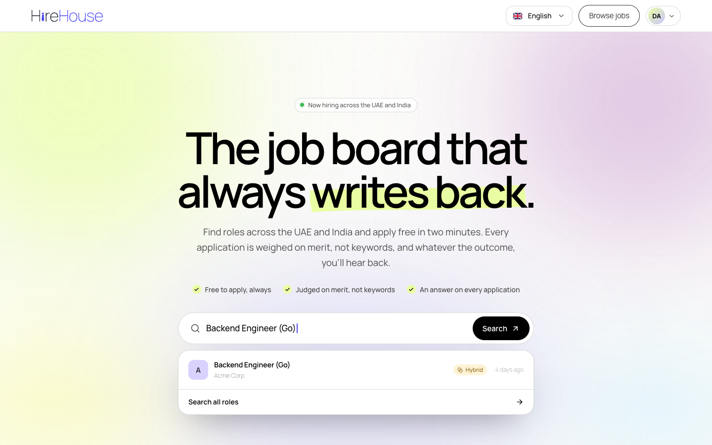

# HireHouse design system

The design handover for **HireHouse** (a Fintrix Inc. product): foundations, components, brand voice and positioning, design tokens, and an agent skill that lets an AI build anything on-brand.

> **Precedence:** the live candidate landing page **is** the design system. Everything in this repo is derived from it. Start with [docs/00-overview.md](docs/00-overview.md).



## Contents

```
docs/
  00-overview.md                         start here: precedence, the system in one screen, how to use, governance
  01-foundations.md                      principles, colour, type, spacing, radii, elevation, imagery, motion, theming
  02-components.md                       inventory, new-component recipe + checklist, component specs, page patterns
  04-brand-voice-and-positioning.md      positioning, audiences, naming, voice, mechanics, claims guardrails, microcopy
  05-known-issues-and-open-questions.md  consolidated tracker: inconsistencies, a11y, copy violations, decisions
tokens/
  tokens.css            CSS custom properties (portable)
  tokens.json           W3C Design Tokens (DTCG)
  tailwind-theme.css    Tailwind v4 @theme reproducing the app's utility names
assets/
  brand/                the full logo kit (see assets/brand/README.md):
    web/                  the exact files the app ships (wordmarks, stacked, app icon, favicon, apple icon)
    svg/  png/            13 identity variants x light/dark, SVG + PNG 512/1024/2048, transparent and on-ground
    email/  legacy/       email rasters; the earlier tieless wordmark (do not use)
    source/               the identity files the exports are generated from
  screenshots/          reference captures of the landing page (desktop, mobile)
skills/
  hirehouse-design-system/   self-contained agent skill (SKILL.md, references, tokens, template, checker)
scripts/
  sync-skill.mjs             copy docs/tokens/assets into the skill after edits
  capture-screenshots.mjs    regenerate the reference screenshots
  export-logos.mjs           regenerate every logo SVG/PNG from the tie identity file
```

## Logos

Every format is in [`assets/brand/`](assets/brand/README.md), with a guide to which variant to use where. Prefer the SVGs in `assets/brand/svg/`.

## Use the tokens

```css
@import "./tokens/tokens.css";           /* plain CSS */
```

```css
@import "tailwindcss";
@import "./tokens/tailwind-theme.css";   /* Tailwind v4: bg-lime, text-indigo, rounded-panel, shadow-float … */
```

Load Manrope (weights 400, 500, 600, 700) from Google Fonts or `next/font/google`. Manrope is the only typeface.

## Use the agent skill

The skill in [`skills/hirehouse-design-system`](skills/hirehouse-design-system) is self-contained, so it works wherever it is copied.

**Claude Code, for one project:**

```bash
mkdir -p .claude/skills && cp -R path/to/hirehouse-design-system/skills/hirehouse-design-system .claude/skills/
```

**Claude Code, for every project:**

```bash
mkdir -p ~/.claude/skills && cp -R skills/hirehouse-design-system ~/.claude/skills/
```

**Other agents** (Codex, Cursor and so on): point the agent at `skills/hirehouse-design-system/SKILL.md` or copy it into the tool's rules folder. The skill tells the agent which reference to read for which task, gives it a starter template, and makes it run the brand checker before handing work back:

```bash
node skills/hirehouse-design-system/scripts/check-brand.mjs path/to/output
```

## Maintain it

1. The landing page changes first (or the change is agreed with design).
2. Update the docs and tokens in the same pull request.
3. Run `node scripts/sync-skill.mjs`.
4. Add an entry to [CHANGELOG.md](CHANGELOG.md).

Open questions and known issues are tracked in [docs/05](docs/05-known-issues-and-open-questions.md).

---

Private and confidential. © Fintrix Inc.
